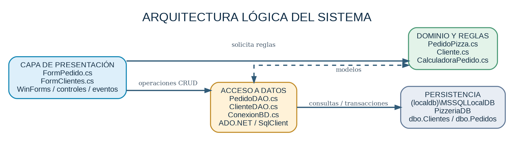
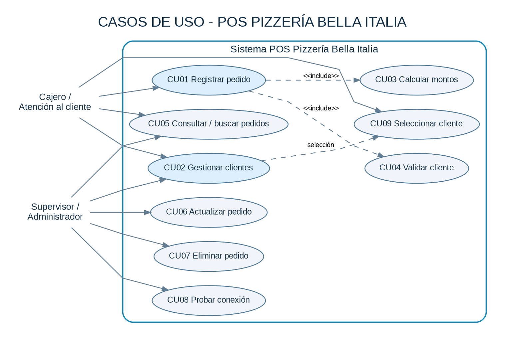
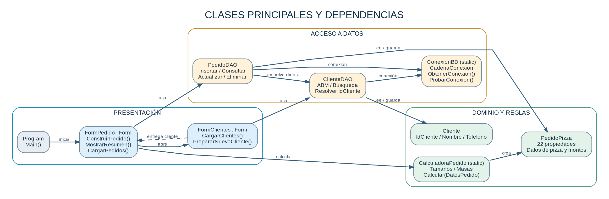
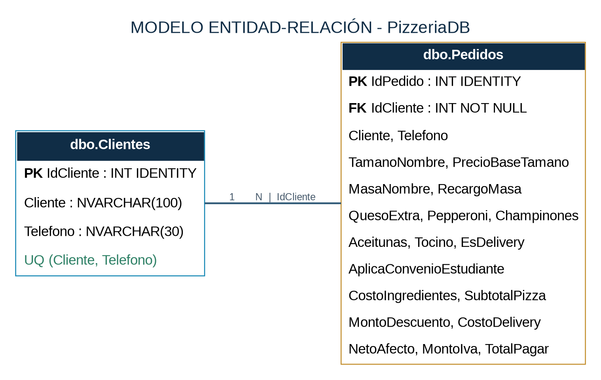

# DOCUMENTACIÓN TÉCNICA DEL PROYECTO
**Sistema POS Pizzería Bella Italia - Concepción**
Documentación técnica de software | Versión de código v4B | ADO.NET + DAO

| Parámetro | Especificación del Proyecto |
| --- | --- |
| Estudiante | Jorge Vera Videla |
| Asignatura | Construcción de Software (PA26-2026) - Código 202700-2 |
| Unidad Temática | Unidad III: Integración de Aplicaciones con Bases de Datos y Mantenibilidad |
| Caso de Estudio | Sistema POS Pizzería Bella Italia (Certamen 2 / Proyecto Integrador) |
| Entorno Tecnológico | C# (.NET 10) \| Windows Forms \| Microsoft.Data.SqlClient 7.1.2 \| SQL Server LocalDB |
| Base de Datos | PizzeriaDB en (localdb)\MSSQLLocalDB |
| Resultados de Aprendizaje | D2.C2-RA3: Construir software aplicando lenguajes de programación de base de datos. D2.C1-RA2: Generar documentación técnica de las aplicaciones programadas. |


| Alcance de esta documentación El documento describe la implementación entregada en el código fuente v4B: formularios WinForms, entidades, reglas de negocio, acceso a datos ADO.NET, operaciones CRUD, consultas parametrizadas y transacciones. El DDL se adjunta en `BDpizzeria/scriptsSql/01_Estructura_PizzeriaDB.sql` y se reproduce en la sección 5. El historial Git está disponible en el repositorio indicado en la sección 7. |
| --- |

## 1. Ficha Técnica y Descripción General del Sistema
Pizzería Bella Italia requiere apoyar la atención y el registro de pedidos mediante una aplicación de escritorio. El sistema permite identificar al cliente por nombre y teléfono, configurar una pizza por tamaño y masa, agregar ingredientes, seleccionar retiro o delivery, aplicar el convenio estudiante/IPVG, calcular los montos e IVA, registrar el pedido en SQL Server LocalDB y mantener un catálogo de clientes junto con el historial de pedidos.

| Parámetro / Componente | Especificación Técnica |
| --- | --- |
| Nombre del Sistema | Sistema Punto de Venta (POS) y Gestión de Pedidos Pizzería Bella Italia |
| Tipo de Aplicación | Aplicación de escritorio Windows Forms |
| Arquitectura lógica | Presentación, Dominio/Reglas, Acceso a Datos y Persistencia (4 estratos funcionales) |
| Lenguaje / Framework | C# sobre .NET 10 para Windows (net10.0-windows) |
| Acceso a Datos | ADO.NET mediante Microsoft.Data.SqlClient 7.1.2 |
| Motor de Base de Datos | SQL Server Express LocalDB: (localdb)\MSSQLLocalDB / PizzeriaDB |
| Patrones y mecanismos | DAO, helper estático de conexión, entidades POO, consultas parametrizadas y SqlTransaction |
| Módulos principales | Program.cs, PedidoPizza.cs, Cliente.cs, CalculadoraPedido.cs, ConexionBD.cs, PedidoDAO.cs, ClienteDAO.cs, FormPedido.cs y FormClientes.cs |
| Control de versiones | Git local / GitHub declarado en la documentación anterior; no se adjuntó historial verificable de commits para v4B |

Objetivo funcional: registrar pedidos calculados de manera consistente, conservar la relación con el cliente y ofrecer funciones de consulta, modificación y eliminación tanto para pedidos como para clientes.
## 2. Diagrama de Arquitectura en Capas
Separación lógica de responsabilidades observada en los archivos y dependencias del código v4B. En términos del modelo de 2 capas: **Capa de Presentación** (GUI WinForms: `FormPedido` y `FormClientes`) y **Capa de Dominio/Datos** (entidades POO, reglas de negocio, DAO y `ConexionBD`), con la persistencia física como estrato de soporte:

**Figura 2.1: Arquitectura lógica del POS; el flujo de datos llega a PizzeriaDB a través de las clases DAO y ConexionBD.**
**Responsabilidades por estrato:**

| Estrato | Responsabilidad / Componentes |
| --- | --- |
| Presentación | FormPedido.cs y FormClientes.cs; reciben entradas, gestionan eventos, presentan resultados y muestran mensajes. Los formularios no crean SqlConnection directamente. |
| Dominio y reglas | PedidoPizza.cs y Cliente.cs representan entidades. CalculadoraPedido.cs contiene las tablas de precios y calcula los importes sin depender de controles visuales. |
| Acceso a Datos | PedidoDAO.cs y ClienteDAO.cs ejecutan SQL parametrizado. ConexionBD.cs centraliza la cadena y la apertura de conexiones. Las transacciones se administran en los DAO. |
| Persistencia | PizzeriaDB en SQL Server LocalDB, con las tablas dbo.Clientes y dbo.Pedidos y la relación por IdCliente. |


| Observación de organización del código Las clases DAO y ConexionBD se encuentran físicamente bajo la carpeta y el namespace PizzeriaBellaItalia.Dominio. En esta documentación se representan en el estrato de Acceso a Datos por la responsabilidad que cumplen, sin alterar su ubicación real en el código. |
| --- |

**Secuencia general de registro de un pedido**

| Etapa | Descripción |
| --- | --- |
| 1. Captura | FormPedido lee cliente, teléfono, tamaño, masa, adicionales, servicio y convenio. |
| 2. Cálculo | ConstruirPedido() genera DatosPedido y llama a CalculadoraPedido.Calcular(). |
| 3. Confirmación | El formulario muestra subtotal, descuento, delivery, IVA y total; solicita confirmación al usuario. |
| 4. Persistencia | PedidoDAO.InsertarPedido() abre conexión y transacción, resuelve el IdCliente y ejecuta INSERT parametrizado. |
| 5. Cierre | Si la inserción retorna un identificador, confirma la transacción; luego el formulario limpia y recarga la grilla. Si ocurre una excepción, intenta rollback y propaga el error. |

## 3. Diagrama de Casos de Uso del Sistema
Interacciones funcionales identificadas en los formularios. Los roles representan perfiles operacionales y no constituyen permisos autenticados por el código entregado.

**Figura 3.1: Casos de uso del POS Pizzería Bella Italia. Las relaciones include señalan validación y cálculo requeridos para registrar un pedido.**

| Actor | Caso de Uso | Descripción Funcional | Relación |
| --- | --- | --- | --- |
| Cajero / Atención | CU01 Registrar Pedido | Captura los datos del cliente y la configuración de la pizza; calcula el total y solicita confirmación antes de guardar. | Principal |
| Cajero / Atención | CU02 Gestionar Clientes | Permite alta, consulta, búsqueda, modificación y eliminación condicionada de clientes. | Principal |
| Cajero / Atención | CU03 Calcular Montos | Aplica tamaño, masa, adicionales, descuento, delivery e IVA mediante CalculadoraPedido. | <<include>> CU01 |
| Cajero / Atención | CU04 Validar Cliente | Exige nombre y teléfono antes de confirmar el registro de un pedido o grabar un cliente. | <<include>> CU01 |
| Cajero / Supervisor | CU05 Consultar Pedidos | Lista todos los pedidos, filtra por nombre de cliente o consulta por IdPedido. | Principal |
| Supervisor | CU06 Actualizar Pedido | Modifica un pedido por ID; resuelve el cliente y actualiza dentro de una transacción. | Administrativo |
| Supervisor | CU07 Eliminar Pedido | Elimina físicamente un pedido por ID, previa confirmación en el formulario. | Administrativo |
| Supervisor / Soporte | CU08 Probar Conexión | Ejecuta ConexionBD.ProbarConexion() e informa el resultado y la cadena de conexión. | Principal |
| Cajero / Atención | CU09 Seleccionar Cliente | Envía nombre y teléfono desde FormClientes a FormPedido mediante CargarClienteDesdeSeleccion(). | Apoyo a CU01 |


| Límite de seguridad El código proporcionado no contiene inicio de sesión, gestión de credenciales ni autorización por rol. “Cajero” y “Supervisor” se utilizan para describir quién ejecutaría funcionalmente las operaciones, no como perfiles validados por la aplicación. |
| --- |

## 4. Diagrama de Clases UML (Dominio y Acceso a Datos)
Clases principales, métodos representativos y dependencias observadas en el código fuente:

**Figura 4.1: Dependencias entre formularios, entidades, reglas de negocio, DAO y helper de conexión.**
**Catálogo de clases**

| Archivo | Clase / Elemento | Responsabilidad |
| --- | --- | --- |
| Program.cs | Program | Punto de entrada. Main() inicializa WinForms y ejecuta FormPedido como formulario principal. |
| Dominio/PedidoPizza.cs | PedidoPizza | Entidad con 22 propiedades: identificadores, datos del cliente, configuración de pizza, indicadores booleanos y montos calculados. |
| Dominio/Cliente.cs | Cliente | Entidad de dbo.Clientes: IdCliente, Nombre y Telefono. |
| Dominio/CalculadoraPedido.cs | CalculadoraPedido (static) | Mantiene Tamanos y Masas; DatosPedido agrupa las entradas; Calcular() retorna un PedidoPizza con los montos. |
| Dominio/ConexionBD.cs | ConexionBD (static) | Centraliza cadenaConexion, expone CadenaConexion, crea conexiones con ObtenerConexion() y comprueba disponibilidad con ProbarConexion(). |
| Dominio/PedidoDAO.cs | PedidoDAO | CRUD de pedidos, búsquedas, lectura completa y resolución transaccional del cliente. |
| Dominio/ClienteDAO.cs | ClienteDAO | ABM de clientes, búsquedas, control de duplicados, validación previa a eliminación y métodos auxiliares transaccionales. |
| Presentacion/FormPedido.cs | FormPedido : Form | Coordina captura, cálculo, consulta, alta, actualización, eliminación y estados de pantalla. |
| Presentacion/FormPedido.Designer.cs | FormPedido (partial) | Declara los controles WinForms, configura su presentación y conecta eventos de la ventana principal. |
| Presentacion/FormClientes.cs | FormClientes : Form | Gestiona clientes y comunica la selección a FormPedido. |
| Presentacion/FormClientes.Designer.cs | FormClientes (partial) | Archivo declarado en la estructura entregada, pero su contenido fue omitido; no es posible documentar su distribución visual. |
| PizzeriaBellaItalia.csproj | Proyecto .NET | Configura net10.0-windows, Nullable, WinForms y Microsoft.Data.SqlClient 7.1.2; excluye carpetas auxiliares del proceso de compilación. |

> Nota de correspondencia: en los requerimientos se menciona `FormPizzeriaCRUD` como nombre genérico del formulario de operaciones. En esta entrega esa responsabilidad se distribuye en **`FormPedido`** (alta, consulta, actualización y eliminación de pedidos) y **`FormClientes`** (ABM de clientes), ambos documentados en el catálogo anterior.

## 5. Modelo Entidad-Relación y Estructura SQL Server LocalDB
Esquema relacional utilizado por los DAO para mantener clientes y pedidos en PizzeriaDB. Estructura DDL adjunta (`BDpizzeria/scriptsSql/01_Estructura_PizzeriaDB.sql`):

```sql
CREATE DATABASE PizzeriaDB;
GO

USE PizzeriaDB;
GO

CREATE TABLE dbo.Clientes (
    IdCliente INT IDENTITY(1,1) NOT NULL,
    Cliente NVARCHAR(100) NOT NULL,
    Telefono NVARCHAR(30) NOT NULL,
    CONSTRAINT PK_Clientes PRIMARY KEY CLUSTERED (IdCliente ASC),
    CONSTRAINT UQ_Clientes_Cliente_Telefono UNIQUE NONCLUSTERED (Cliente ASC, Telefono ASC)
);
GO

CREATE TABLE dbo.Pedidos (
    IdPedido INT IDENTITY(1,1) NOT NULL,
    IdCliente INT NOT NULL,
    Cliente NVARCHAR(100) NOT NULL,
    Telefono NVARCHAR(30) NOT NULL,
    TamanoNombre NVARCHAR(50) NOT NULL,
    PrecioBaseTamano INT NOT NULL,
    MasaNombre NVARCHAR(50) NOT NULL,
    RecargoMasa INT NOT NULL,
    QuesoExtra BIT NOT NULL,
    Pepperoni BIT NOT NULL,
    Champinones BIT NOT NULL,
    Aceitunas BIT NOT NULL,
    Tocino BIT NOT NULL,
    EsDelivery BIT NOT NULL,
    AplicaConvenioEstudiante BIT NOT NULL,
    CostoIngredientes INT NOT NULL,
    SubtotalPizza INT NOT NULL,
    MontoDescuento INT NOT NULL,
    CostoDelivery INT NOT NULL,
    NetoAfecto INT NOT NULL,
    MontoIva INT NOT NULL,
    TotalPagar INT NOT NULL,
    CONSTRAINT PK_Pedidos PRIMARY KEY CLUSTERED (IdPedido ASC),
    CONSTRAINT FK_Pedidos_Clientes FOREIGN KEY (IdCliente) REFERENCES dbo.Clientes (IdCliente)
);
GO
```


**Figura 5.1: Relación uno a muchos entre dbo.Clientes y dbo.Pedidos mediante IdCliente.**
**Tabla dbo.Clientes**

| Campo SQL | Tipo de Dato | Restricción | Propiedad C# |
| --- | --- | --- | --- |
| IdCliente | INT | PK, IDENTITY(1,1) | int IdCliente |
| Cliente | NVARCHAR(100) | NOT NULL | string Nombre |
| Telefono | NVARCHAR(30) | NOT NULL | string Telefono |
| (Cliente, Telefono) | UNIQUE | UQ_Clientes_Cliente_Telefono | Control de duplicados en ClienteDAO |

**Tabla dbo.Pedidos - identificación y configuración**

| Campo SQL | Tipo de Dato | Restricción | Propiedad C# |
| --- | --- | --- | --- |
| IdPedido | INT | PK, IDENTITY(1,1) | int IdPedido |
| IdCliente | INT | FK a dbo.Clientes, NOT NULL | int IdCliente |
| Cliente | NVARCHAR(100) | NOT NULL | string Cliente |
| Telefono | NVARCHAR(30) | NOT NULL | string Telefono |
| TamanoNombre | NVARCHAR(50) | NOT NULL | string TamanoNombre |
| PrecioBaseTamano | INT | NOT NULL | int PrecioBaseTamano |
| MasaNombre | NVARCHAR(50) | NOT NULL | string MasaNombre |
| RecargoMasa | INT | NOT NULL | int RecargoMasa |
| QuesoExtra / Pepperoni | BIT | NOT NULL | bool QuesoExtra / Pepperoni |
| Champinones / Aceitunas | BIT | NOT NULL | bool Champinones / Aceitunas |
| Tocino | BIT | NOT NULL | bool Tocino |
| EsDelivery | BIT | NOT NULL | bool EsDelivery |
| AplicaConvenioEstudiante | BIT | NOT NULL | bool AplicaConvenioEstudiante |

## 5. Modelo Entidad-Relación y Estructura SQL Server LocalDB (continuación)
Campos de importes persistidos en dbo.Pedidos y reglas de integridad referencial:

| Nota sobre los tipos SQL Los nombres, tipos y restricciones se corroboran con el DDL adjunto y con las sentencias SQL de PedidoDAO.cs y ClienteDAO.cs. Los tipos presentes son INT, NVARCHAR y BIT (además de UNIQUE y FK). El esquema entregado no incluye columnas DATETIME: el registro de pedidos no persiste fecha, por lo que no se documenta un campo inexistente. |
| --- |

**Tabla dbo.Pedidos - importes calculados**

| Campo SQL | Tipo de Dato | Restricción | Propiedad C# |
| --- | --- | --- | --- |
| CostoIngredientes | INT | NOT NULL | int CostoIngredientes |
| SubtotalPizza | INT | NOT NULL | int SubtotalPizza |
| MontoDescuento | INT | NOT NULL | int MontoDescuento |
| CostoDelivery | INT | NOT NULL | int CostoDelivery |
| NetoAfecto | INT | NOT NULL | int NetoAfecto |
| MontoIva | INT | NOT NULL | int MontoIva |
| TotalPagar | INT | NOT NULL | int TotalPagar |

**Relaciones e integridad**

| Regla / Relación | Implementación observada |
| --- | --- |
| Clientes 1 - N Pedidos | dbo.Pedidos.IdCliente referencia dbo.Clientes.IdCliente. PedidoDAO resuelve el IdCliente antes de insertar o actualizar. |
| Identidad del cliente | La pareja Cliente + Telefono se mantiene única mediante UQ_Clientes_Cliente_Telefono; SQL Server puede informar error 2601 o 2627. |
| Eliminación de cliente | FormClientes comprueba ValidaClienteSinPedidos() antes de llamar a EliminarCliente(). El comentario del DAO indica que la FK impide borrar clientes con pedidos asociados. |
| Datos repetidos en Pedidos | dbo.Pedidos almacena también Cliente y Telefono. ActualizarCliente() sincroniza esos campos en dbo.Pedidos dentro de la misma transacción. |
| Transacción de pedido | InsertarPedido() y ActualizarPedido() resuelven o crean el cliente y ejecutan la operación sobre Pedidos dentro de una misma SqlTransaction. |

**Reglas de negocio implementadas en CalculadoraPedido.cs**

| Concepto | Opción | Valor |
| --- | --- | --- |
| Tamaño | Personal | $5.000 |
| Tamaño | Mediana (predeterminado) | $8.500 |
| Tamaño | Familiar | $12.000 |
| Masa | Masa Tradicional / Masa Delgada | $0 |
| Masa | Borde de Queso | $1.500 |
| Adicionales | Queso Extra, Pepperoni, Champiñones, Aceitunas y Tocino | $800 cada uno |
| Descuento | Convenio Estudiante / IPVG | 10% del subtotal pizza |
| Servicio | Delivery | $2.000 |
| Impuesto | IVA chileno | 19% del neto afecto |


| Fórmula de cálculo aplicada CostoIngredientes = cantidad de adicionales × $800. SubtotalPizza = precio base del tamaño + recargo de masa + CostoIngredientes. MontoDescuento = 10% del SubtotalPizza cuando se activa el convenio. NetoAfecto = SubtotalPizza - MontoDescuento + CostoDelivery. MontoIva = 19% del NetoAfecto. TotalPagar = NetoAfecto + MontoIva. Los importes se almacenan como int y los porcentajes se convierten mediante cast a int en el código. |
| --- |

## 6. Mapeo de Formularios WinForms, Controles y Eventos
Controles identificados en FormPedido.Designer.cs y manejadores implementados en FormPedido.cs:
**FormPedido.cs - formulario principal**

| Control / Grupo | Name | Evento | Acción / Función Ejecutada |
| --- | --- | --- | --- |
| Formulario | FormPedido | Load | Inicializa combos con CalculadoraPedido, deshabilita resumen, configura ayuda y carga pedidos. |
| Texto cliente | txtCliente | Entrada / validación | Captura el nombre; se exige no vacío para procesar. También se utiliza como criterio de búsqueda. |
| Texto teléfono | txtTelefono | Entrada / validación | Captura teléfono; se exige no vacío para procesar. |
| ID pedido | txtIdPedido | Búsqueda / actualización / eliminación | Se valida como entero positivo para operaciones por identificador. |
| Buscar cliente | btnBuscaPedidosXCliente | Click | Filtra pedidos mediante PedidoDAO.BuscarPedidosPorCliente() con LIKE. |
| Buscar por ID | btnBuscarPedidoPorId | Click | Consulta PedidoDAO.ObtenerPedidoPorId() y carga los datos del pedido. |
| Abrir clientes | btnEditaClientes | Click | Abre FormClientes mediante ShowDialog(). |
| Tamaño | cboTamano | SelectedIndexChanged | Dispara Calculo_Changed para recalcular los importes. |
| Masa | cboMasa | SelectedIndexChanged | Dispara Calculo_Changed para recalcular los importes. |
| Adicionales | chkQuesoExtra, chkPepperoni, chkChampinones, chkAceitunas, chkTocino | CheckedChanged | Cada selección actualiza el cálculo; todos los adicionales tienen valor unitario de $800. |
| Servicio | rdbRetiro, rdbDelivery | CheckedChanged | Determina si se añade el costo de delivery de $2.000. |
| Convenio | chkConvenioEstudiante | CheckedChanged | Activa el descuento de 10% sobre SubtotalPizza. |
| Calcular / Grabar | btnCalcular | Click | Valida cliente, construye PedidoPizza, muestra resumen y pide confirmación antes de insertar. |
| Nuevo pedido | btnLimpiar | Click | Restablece campos, opciones, montos y estado del resumen. |
| Actualizar | btnActualizarPedido | Click | Valida ID y cliente; actualiza mediante PedidoDAO.ActualizarPedido(). |
| Eliminar | btnEliminarPedido | Click | Solicita confirmación y elimina por IdPedido. |
| Todos los pedidos | btnTodosLosPedidos | Click | Recarga la grilla con PedidoDAO.ObtenerPedidosDataTable(). |
| Probar conexión | btnProbarConexion | Click | Ejecuta ConexionBD.ProbarConexion() y muestra cadena y resultado. |
| Salir | btnConfirmar | Click | Solicita confirmación y cierra la ventana. |
| Grilla de pedidos | dgvPedidos | CellClick | Obtiene IdPedido de la fila seleccionada y llama a VistaPedido(). |
| Ayuda / estado | lblAyuda | MouseEnter / MouseLeave en botones | Muestra instrucciones contextuales y mensajes de estado; el color cambia según éxito o error. |
| Resumen de pago | grpResumen y lbl*Valor | Actualización desde código | Muestra subtotal, descuento, delivery, IVA y total; se habilita al calcular o cargar un pedido. |

Control de recálculo: Calculo_Changed() evita ejecutar durante la carga o limpieza mediante cargandoFormulario, exige que grpResumen esté habilitado y que exista texto de cliente; posteriormente invoca MostrarResumen(ConstruirPedido()).
## 6. Mapeo de Formularios WinForms, Controles y Eventos (continuación)
Operaciones de mantenimiento del catálogo de clientes y catálogo de métodos relevantes:
**FormClientes.cs - administración de clientes**

| Control / Grupo | Name | Evento | Acción / Función Ejecutada |
| --- | --- | --- | --- |
| Formulario | FormClientes | Load | Carga clientes y prepara un registro nuevo. |
| Campos de entrada | txtNombre, txtTelefono | Entrada de datos | Capturan los datos usados para insertar, actualizar, buscar y seleccionar un cliente. |
| Grabar / Actualizar | btnGrabar | Click | Valida datos, comprueba duplicados y ejecuta InsertarCliente() o ActualizarCliente(). |
| Eliminar | btnElimina | Click | Manejador implementado: verifica pedidos asociados, solicita confirmación y elimina por IdCliente. |
| Listar | btnListar | Click | Manejador implementado: prepara registro nuevo y carga todos los clientes. |
| Nuevo | btnNuevo | Click | Manejador implementado: limpia campos y restablece idClienteSeleccionado = 0. |
| Buscar | btnBuscar | Click | Manejador implementado: filtra por nombre si está informado; en caso contrario utiliza teléfono. |
| Seleccionar | btnSelecciona | Click | Manejador implementado: envía nombre y teléfono a FormPedido mediante CargarClienteDesdeSeleccion(). |
| Grilla clientes | dgvClientes | CellDoubleClick (suscrito en constructor) | Carga la fila actual en modo edición y cambia el texto del botón a Actualizar. |

**Catálogo de métodos principales**

| Clase | Método / Función | Responsabilidad |
| --- | --- | --- |
| CalculadoraPedido | Calcular(DatosPedido) : PedidoPizza | Valida tamaño/masa contra diccionarios y calcula todos los importes. |
| ConexionBD | ObtenerConexion() : SqlConnection / ProbarConexion() : bool | Abre una conexión nueva y libera la conexión si falla; comprueba estado Open. |
| PedidoDAO | InsertarPedido(PedidoPizza) : bool | Resuelve cliente, parametriza INSERT, obtiene SCOPE_IDENTITY y confirma/revierte transacción. |
| PedidoDAO | ObtenerPedidosDataTable() / BuscarPedidosPorCliente(string) | Retorna datos resumidos para la grilla, con JOIN a dbo.Clientes; filtra mediante LIKE. |
| PedidoDAO | ObtenerPedidoPorId(int) : PedidoPizza? | Lee la fila completa y devuelve null cuando no existe. |
| PedidoDAO | ActualizarPedido(PedidoPizza) / EliminarPedido(int) | Actualiza de forma transaccional o elimina el pedido por identificador. |
| ClienteDAO | InsertarCliente() / ActualizarCliente() / EliminarCliente() | Mantiene el catálogo; ActualizarCliente sincroniza nombre y teléfono en Pedidos. |
| ClienteDAO | ObtenerOCrearIdCliente() / ValidaClienteSinPedidos() | Resuelve FK del pedido y comprueba que no existan pedidos asociados antes de la baja. |
| ClienteDAO | BuscarClientesDataTable() / ObtenerClientesDataTable() | Lista o filtra clientes por nombre y teléfono. |
| FormPedido | ConstruirPedido() / MostrarResumen() / LimpiarFormulario() | Convierte los controles en datos, presenta los importes y restablece la pantalla. |
| FormClientes | PrepararNuevoCliente() / PresentaCamposParaEdicion() / CargarClientes() | Administra los modos de alta, edición y consulta. |

## 7. Trazabilidad y Registro Incremental de Versiones (Bitácora Git)
Trazabilidad técnica de los componentes incluidos en el código fuente recibido:
La carpeta informada para esta entrega es `pizzeriaBellaItalia-BD-DAO-v4B\Codigo_Funcional`. El inventario siguiente permite relacionar los principales artefactos con sus responsabilidades. El repositorio remoto es `https://github.com/sintesisLabEstudio/pizzeriaBellaItalia-BD-DAO`, rama `main`, con el código de esta entrega publicado en el commit `2cfac45` (*Agrega imagenes de la documentacion al repositorio*), precedido por `d96a216` (*Versiona solo Codigo_Funcional*) y `8964188` (merge que conservó el historial remoto).

| Hito / Área | Archivos relacionados | Evidencia funcional |
| --- | --- | --- |
| Inicio de aplicación | Program.cs | Inicialización del entorno WinForms y apertura de FormPedido. |
| Configuración del proyecto | PizzeriaBellaItalia.csproj | Target .NET 10 Windows, Nullable, WinForms, SqlClient 7.1.2 y exclusiones de carpetas auxiliares. |
| Modelo de dominio | PedidoPizza.cs / Cliente.cs | Entidades utilizadas por formularios y DAO. |
| Reglas de negocio | CalculadoraPedido.cs | Catálogos de tamaños/masas y cálculo centralizado de subtotal, descuento, delivery, IVA y total. |
| Conexión a datos | ConexionBD.cs | Cadena única a LocalDB, apertura y prueba de conexión. |
| Persistencia de pedidos | PedidoDAO.cs | Inserción, consulta, búsqueda, actualización, eliminación y transacciones. |
| Persistencia de clientes | ClienteDAO.cs | ABM, búsqueda, control de duplicados, validación de baja y reutilización transaccional. |
| Interfaz de pedidos | FormPedido.cs / FormPedido.Designer.cs | Captura, cálculo, visualización de resumen y gestión de pedidos. |
| Interfaz de clientes | FormClientes.cs / FormClientes.Designer.cs | ABM, búsqueda, selección y transferencia de datos al formulario de pedidos. |

**Dependencias técnicas y configuración**

| Parámetro | Valor identificado |
| --- | --- |
| Framework | net10.0-windows |
| Tipo de salida | WinExe |
| Interfaz | UseWindowsForms = true |
| Nullable | Nullable = enable |
| Proveedor SQL | Microsoft.Data.SqlClient 7.1.2 |
| Servidor | (localdb)\MSSQLLocalDB |
| Base de datos | PizzeriaDB |
| Cadena configurada | Server=(localdb)\MSSQLLocalDB;Database=PizzeriaDB;Integrated Security=True;TrustServerCertificate=True; |
| Alternativa de despliegue | Instancia nombrada `Server=.\SQLEXPRESS;Database=PizzeriaDB;Integrated Security=True;TrustServerCertificate=True;` (dejada como comentario en `ConexionBD.cs`). No requiere cambios en los DAO; solo se sustituye la cadena activa. |
| Carpetas excluidas | BDpizzeria\pruebaDao, FuentesYbase y ejecutablePortable (Compile / None / EmbeddedResource) |

**Aspectos de implementación que deben conservarse**
- Los formularios trabajan con PedidoDAO y ClienteDAO; la apertura de conexiones se concentra en ConexionBD.
- Las consultas que reciben criterios o identificadores utilizan parámetros SQL (por ejemplo, @IdPedido, @Nombre, @Telefono y @Filtro).
- InsertarPedido() y ActualizarPedido() agrupan la resolución/creación del cliente y la operación de pedido en una transacción; el rollback se intenta ante excepciones.
- La restricción UNIQUE de nombre y teléfono se traduce en mensajes comprensibles mediante ClienteDAO.EsClienteDuplicado() para los errores SQL 2601 y 2627.
- El cálculo se concentra en CalculadoraPedido para evitar que la interfaz replique reglas financieras.
