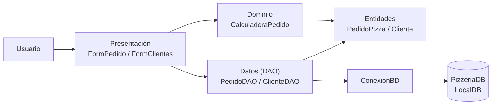
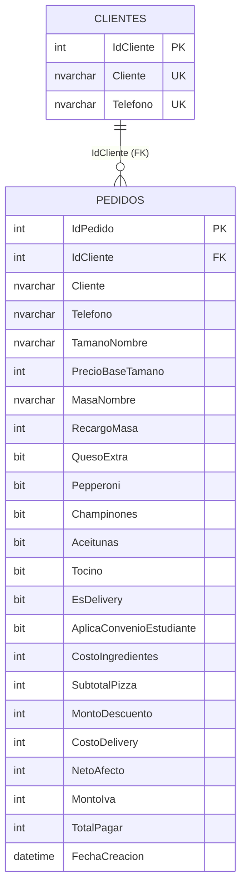

# Pizzería Bella Italia — Gestión integral de pedidos

[](https://dotnet.microsoft.com/)
[](https://learn.microsoft.com/dotnet/desktop/winforms/)
[](https://learn.microsoft.com/sql/database-engine/configure-windows/sql-server-express-localdb)
[](#arquitectura)
[](#información-académica)

Aplicación de escritorio para registrar y administrar pedidos de una pizzería, con persistencia en **SQL Server LocalDB** mediante **ADO.NET** y **patrón DAO** en una arquitectura en capas.

Trabajo final de **Construcción de Software** — Instituto Profesional Virginio Gómez, Sede Concepción (PA26-2026).

---

## Tabla de contenidos

- [Características](#características)
- [Stack tecnológico](#stack-tecnológico)
- [Arquitectura](#arquitectura)
- [Estructura del repositorio](#estructura-del-repositorio)
- [Reglas de negocio](#reglas-de-negocio)
- [Modelo de datos](#modelo-de-datos)
- [Comandos de base de datos](#comandos-de-base-de-datos)
- [Inicio rápido](#inicio-rápido)
- [Verificación](#verificación)
- [Documentación](#documentación)
- [Información académica](#información-académica)

---

## Características

- **CRUD completo** de pedidos: alta, listado, búsqueda por cliente (LIKE), búsqueda por ID, actualización y eliminación con confirmación.
- **ABM de clientes** con validación de duplicados y bloqueo de borrado cuando tienen pedidos asociados.
- **Cálculo en vivo** del detalle de pago: tamaño, masa, ingredientes, delivery, convenio estudiante, IVA y total.
- **Consultas 100 % parametrizadas** (sin inyección SQL) y manejo amigable de errores de restricción (`2601/2627` → «Cliente duplicado»).
- **Integridad referencial** real: `Pedidos.IdCliente → Clientes.IdCliente`, con restricción única de cliente/teléfono.
- **Comandos portables**: sin rutas absolutas; localizan `sqlcmd`/`sqllocaldb` y resuelven las rutas en tiempo de ejecución, en cualquier equipo.
- **Respaldo por copia de archivos** con confirmación antes de sobrescribir y visor offline de las copias.

## Stack tecnológico

| Capa | Tecnología |
|---|---|
| Lenguaje | C# 12 / .NET 10 |
| UI | Windows Forms (`net10.0-windows`) |
| Persistencia | SQL Server LocalDB · `(localdb)\MSSQLLocalDB` |
| Acceso a datos | ADO.NET · `Microsoft.Data.SqlClient` 7.1.2 |
| Arquitectura | Capas + DAO (Presentation / Domain / Data) |
| Herramientas | Visual Studio 2022+ · `sqlcmd` · `sqllocaldb` |

## Arquitectura



- **Presentación** (`Presentacion/`): captura eventos, lee controles y muestra resultados. No construye SQL.
- **Dominio** (`Dominio/`): entidades, reglas de negocio desacopladas de la UI y DAOs.
- **Datos** (`Dominio/*DAO.cs`): SQL parametrizado, transacciones y `SCOPE_IDENTITY()`.
- **Conexión** (`Dominio/ConexionBD.cs`): cadena única y prueba de conectividad.

> Detalle completo: [arquitectura y métodos](Codigo_Funcional/README.md#2-arquitectura-y-capas) · [diagramas Mermaid](estudio/13_DIAGRAMA_FLUJO.md).

## Estructura del repositorio

```
.
├── Codigo_Funcional/
│   ├── Program.cs                  Punto de entrada
│   ├── PizzeriaBellaItalia.csproj  Proyecto .NET 10 WinForms
│   ├── PizzeriaBellaItalia.slnx    Solución
│   ├── README.md                   Documentación técnica del código
│   ├── Dominio/                    6 clases (entidades, reglas, DAO, conexión)
│   ├── Presentacion/               2 formularios + Designer + recursos
│   └── BDpizzeria/
│       ├── pizzeriaDB.mdf / .ldf   Base de datos en vivo
│       ├── comandos/
│       │   ├── BAT/                7 .bat numerados (01…07)
│       │   ├── SQL/                8 .sql con la misma numeración
│       │   └── README.txt          Orden de uso y portabilidad
│       └── respaldo/
│           ├── pizzeriaDB.mdf/.ldf Copias de los originales
│           └── verRegistrosTablas.bat/.sql   Visor offline
├── estudio/                        Consigna, guías, análisis y diagramas (00…15)
└── pizzeriaBellaItalia-BD-DAO-v3_entrega.zip   Paquete de entrega
```

## Reglas de negocio

| Concepto | Regla |
|---|---|
| Tamaños | Personal 5.000 · Mediana 8.500 · Familiar 12.000 CLP |
| Masas | Tradicional 0 · Delgada 0 · Borde de queso +1.500 |
| Ingredientes extra | 800 CLP por opción activa (5 disponibles) |
| Convenio estudiante | −10 % sobre el subtotal |
| Delivery | +2.000 CLP |
| IVA | 19 % sobre `(subtotal − descuento + delivery)` |
| Total | `neto + IVA` |

Implementadas en `CalculadoraPedido.Calcular()` y reutilizadas por el recálculo en vivo de la interfaz. Montos en `int` (CLP sin decimales).

## Modelo de datos



`UK` = restricción `UQ_Clientes_Cliente_Telefono`. La FK usa `ON UPDATE CASCADE / ON DELETE NO ACTION`. Hay índices en `Cliente`, `IdCliente` y `FechaCreacion`.

Cadena de conexión (`Codigo_Funcional/Dominio/ConexionBD.cs`):

```
Server=(localdb)\MSSQLLocalDB;Database=PizzeriaDB;Integrated Security=True;TrustServerCertificate=True;
```

## Comandos de base de datos

Ejecutar desde `Codigo_Funcional/BDpizzeria/comandos/BAT`.

| # | Comando | Descripción |
|---|---|---|
| 01 | `creaBaseDatosP-01.bat` | Crea la base y las tablas desde cero |
| 02 | `cargaBaseDatos-02.bat` | Adjunta la BD y la deja en `MULTI_USER` (**obligatorio**) |
| 03 | `verEstadoConexion-03.bat` | Diagnóstico: instancia, estado, modo, ruta y filas |
| 04 | `verTablas-04.bat` | Lista tablas, estructura y registros |
| 05 | `respaldarBaseDatos-05.bat` | Copia `.mdf`/`.ldf` a `respaldo\`; confirma antes de sobrescribir |
| — | `respaldo/verRegistrosTablas.bat` | Muestra el contenido de las copias de `respaldo/` |
| 06 | `vaciaBaseDatos-06.bat` | Borra pedidos/clientes y reinicia los IDENTITY |
| 07 | `desconectaBase-07.bat` | Desadjunta sin borrar archivos |

Los scripts no contienen rutas absolutas: buscan `sqlcmd` en ODBC 140–180, crean/inician LocalDB si hace falta y calculan la ubicación de los archivos en tiempo de ejecución.

## Inicio rápido

**Requisitos**

- Windows con .NET 10 SDK y carga de trabajo *Desarrollo de escritorio .NET*.
- Visual Studio 2022+ (o abrir directamente el `.csproj`).
- SQL Server LocalDB y paquete NuGet `Microsoft.Data.SqlClient` (se restaura automáticamente).

**Pasos**

```powershell
# 1) Clonar
git clone https://github.com/sintesisLabEstudio/pizzeriaBellaItalia-BD-DAO.git
cd pizzeriaBellaItalia-BD-DAO

# 2) Compilar (restaura NuGet)
dotnet build Codigo_Funcional/PizzeriaBellaItalia.csproj

# 3) Preparar la base de datos
cd Codigo_Funcional\BDpizzeria\comandos\BAT
cargaBaseDatos-02.bat

# 4) Ejecutar desde Visual Studio (F5) o:
dotnet run --project ..\..\..\PizzeriaBellaItalia.csproj
```

>Si el entorno es nuevo y no hay archivos `.mdf/.ldf`, ejecutar primero `creaBaseDatosP-01.bat`.

## Verificación

| Comando | Resultado esperado |
|---|---|
| `dotnet build` | 0 errores / 0 advertencias |
| `verEstadoConexion-03.bat` | `RESULTADO: TODO OK` · BD `ONLINE`, `MULTI_USER` |
| `verTablas-04.bat` | `Clientes` y `Pedidos` con sus registros |
| `verRegistrosTablas.bat` | Muestra las copias sin modificar la base en vivo |

## Documentación

| Recurso | Contenido |
|---|---|
| [README técnico](Codigo_Funcional/README.md) | Código, capas, reglas, BD y comandos |
| [Índice de estudio](estudio/00_INDICE.txt) | Secuencia de lectura de los 16 documentos |
| [Resumen del código](estudio/07_ResumenCodigo.txt) | Clases y métodos de la versión actual |
| [Flujo por botón](estudio/12_flujo.txt) | Acciones de la interfaz paso a paso |
| [Diagramas Mermaid](estudio/13_DIAGRAMA_FLUJO.md) | Archivo → clase → método → pantalla |
| [Instrucciones de compilación](estudio/15_INSTRUCCIONES_COMPILACION.txt) | Guía detallada de entorno y ejecución |
| [ZIP de entrega](pizzeriaBellaItalia-BD-DAO-v3_entrega.zip) | Paquete completo listo para entregar |

## Información académica

- **Asignatura**: Construcción de Software (202700-2 / PA26-2026)
- **Institución**: Instituto Profesional Virginio Gómez — Sede Concepción
- **Unidad**: III — Integración de aplicaciones con bases de datos relacionales
- **Resultado de aprendizaje**: D2.C2-RA3 — soluciones con persistencia en BD relacional y arquitectura DAO en capas
- **Entrega**: 25 de noviembre, 21:30 (100 puntos)

Los documentos originales de la consigna se conservan en [`estudio/`](estudio/) (`02_requerimientos.txt`, `03_guia.txt` y los PDFs).
