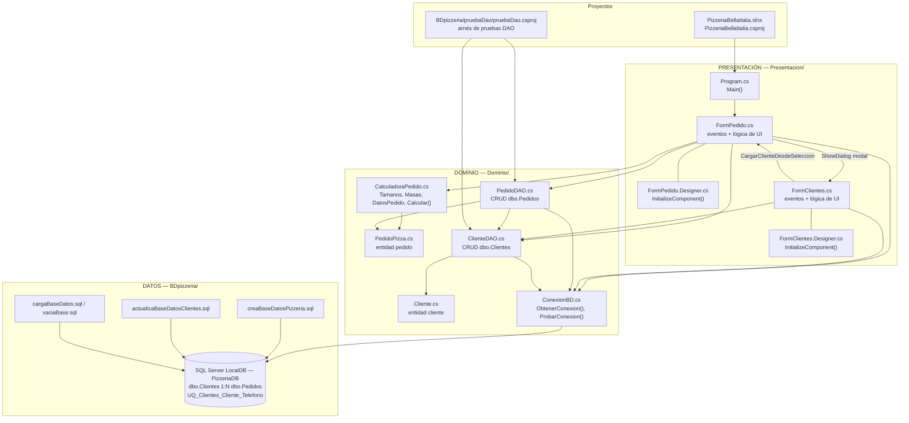
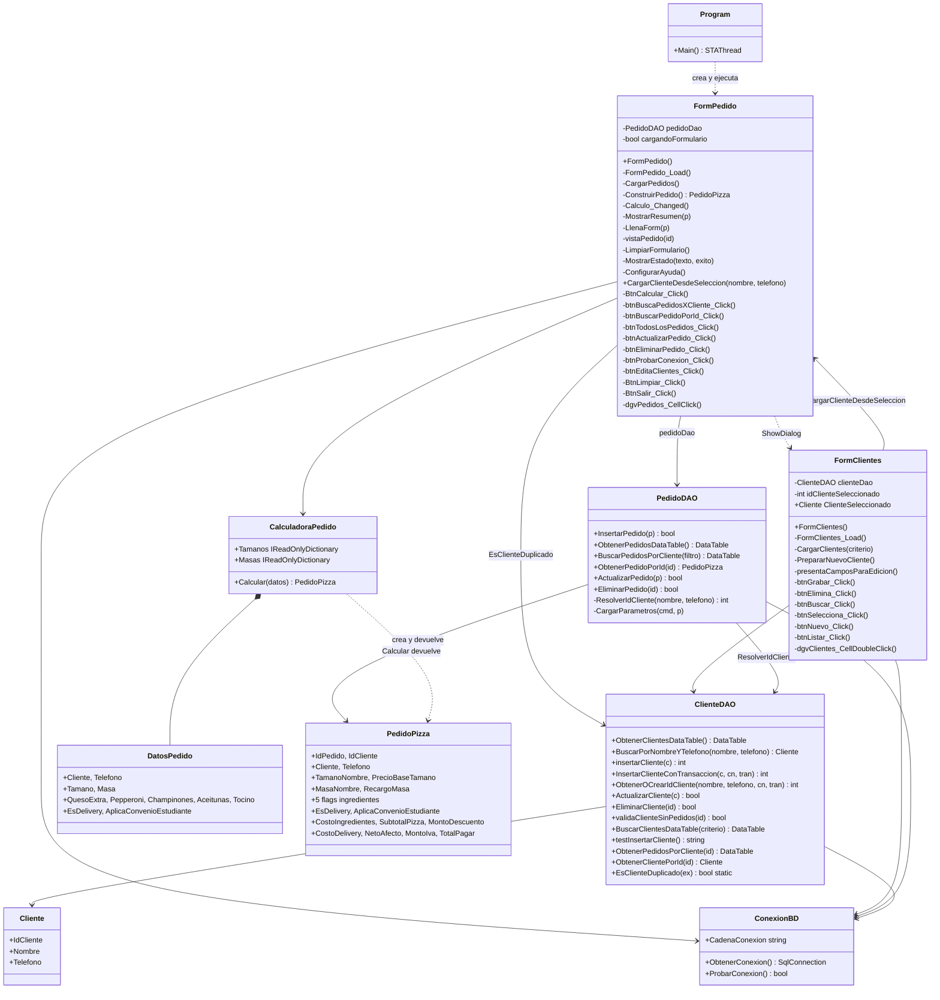
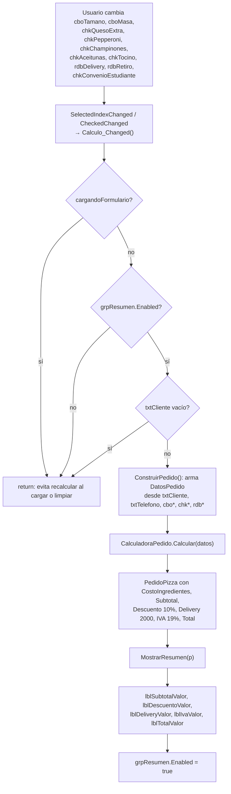
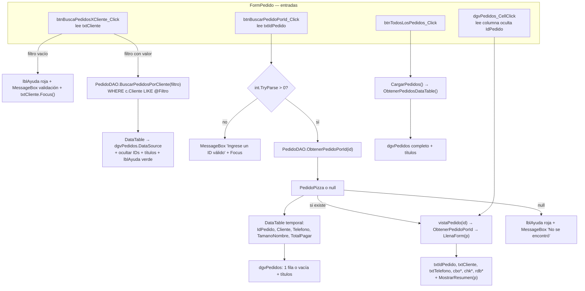
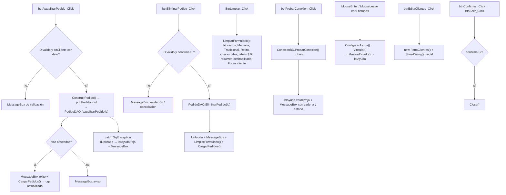
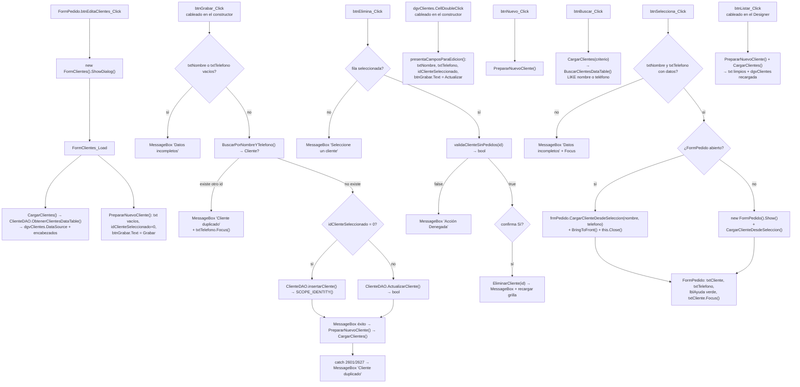
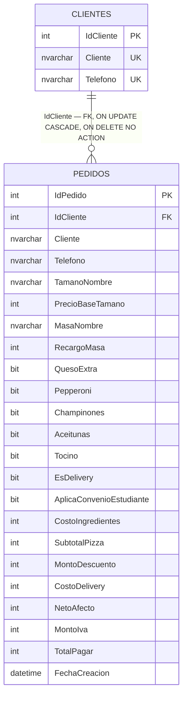

# Diagramación del flujo completo — Pizzería Bella Italia

Documentación del recorrido **archivo → clase → método → objeto → respuesta en pantalla** para las dos pantallas del sistema (`FormPedido` y `FormClientes`). Incluye el estado actual del código: restricción `UQ_Clientes_Cliente_Telefono` aplicada y MessageBox de cliente duplicado.

---

## 1. Mapa de archivos → capas



---

## 2. Diagrama de clases



---

## 3. Flujo de arranque (de `Program.cs` a la grilla)

```mermaid
sequenceDiagram
    autonumber
    participant P as Program.cs
    participant F as FormPedido
    participant D as Designer.cs
    participant C as CalculadoraPedido
    participant DAO as PedidoDAO
    participant CN as ConexionBD
    participant DB as PizzeriaDB
    participant UI as Controles

    P->>P: Main() [STAThread]
    P->>P: ApplicationConfiguration.Initialize()
    P->>F: new FormPedido()
    F->>D: InitializeComponent()
    D-->>UI: crea grpCliente, grpPizza, grpIngredientes, grpEntrega, grpResumen, dgvPedidos, lblAyuda
    D-->>UI: cablea Click, CheckedChanged, SelectedIndexChanged, CellClick, Load
    P->>F: Application.Run(form)
    UI->>F: Load → FormPedido_Load()
    F->>F: cargandoFormulario = true
    F->>C: Tamanos.Keys / Masas.Keys
    C-->>F: diccionarios
    F->>UI: cboTamano.Items = Personal / Mediana / Familiar → SelectedItem = Mediana
    F->>UI: cboMasa.Items = Traditional / Delgada / Borde de Queso → SelectedItem = Masa Tradicional
    F->>UI: grpResumen.Enabled = false; lbl*Valor = "$ 0 CLP"
    F->>F: cargandoFormulario = false; ConfigurarAyuda()
    F->>DAO: CargarPedidos() → ObtenerPedidosDataTable()
    DAO->>CN: ObtenerConexion()
    CN->>DB: SELECT con INNER JOIN dbo.Clientes ORDER BY IdPedido DESC
    DB-->>DAO: DataTable
    DAO-->>F: DataTable
    F->>UI: dgvPedidos.DataSource = DataTable
    F->>UI: oculta IdPedido e IdCliente; títulos Cliente, Teléfono, Tamaño, Total a Pagar
```

---

## 4. Flujo de cálculo en vivo (`Detalle de Pago`)



**Reglas aplicadas por `Calcular()`:** tamaño (5.000 / 8.500 / 12.000) + masa (0 / 0 / 1.500) + $800 por extra; descuento 10% sobre subtotal; delivery $2.000; IVA 19%; total = neto + IVA.

---

## 5. Flujo completo: Calcular / Grabar (CREATE)

```mermaid
sequenceDiagram
    autonumber
    actor U as Usuario
    participant FP as FormPedido
    participant UI as Resumen/MessageBox/lblAyuda
    participant CALC as CalculadoraPedido
    participant PDO as PedidoDAO
    participant CDO as ClienteDAO
    participant CN as ConexionBD
    participant DB as PizzeriaDB

    U->>FP: click btnCalcular
    FP->>FP: valida txtCliente
    alt txtCliente vacío
        FP->>UI: MessageBox "Ingrese el nombre del cliente" + txtCliente.Focus()
    else válido
        FP->>FP: ConstruirPedido() lee controles
        FP->>CALC: Calcular(DatosPedido)
        CALC-->>FP: PedidoPizza con montos
        FP->>UI: MostrarResumen() → 5 labels + grpResumen.Enabled = true
        FP->>UI: MessageBox "¿Grabar pedido? Total: $..."
        alt confirma Sí
            FP->>PDO: InsertarPedido(p)
            PDO->>CDO: ResolverIdCliente(nombre, telefono)
            CDO->>DB: SELECT IdCliente WHERE Cliente y Telefono
            alt cliente existe
                DB-->>CDO: IdCliente existente
            else cliente nuevo
                CDO->>DB: INSERT Clientes + SCOPE_IDENTITY()
                DB-->>CDO: nuevo IdCliente
            end
            CDO-->>PDO: p.IdCliente
            PDO->>CN: ObtenerConexion() + BeginTransaction()
            PDO->>DB: INSERT Pedidos (21 columnas) + SELECT SCOPE_IDENTITY()
            DB-->>PDO: IdPedido generado
            PDO->>DB: COMMIT
            PDO-->>FP: true
            FP->>UI: lblAyuda verde + MessageBox "Pedido guardado"
            FP->>FP: LimpiarFormulario()
            FP->>PDO: CargarPedidos() → ObtenerPedidosDataTable()
            PDO-->>FP: DataTable actualizado
            FP->>UI: dgvPedidos.DataSource + ocultar IDs + títulos
        else SqlException 2601/2627
            DB-->>PDO: violación UQ_Clientes_Cliente_Telefono
            PDO-->>FP: excepción
            FP->>UI: lblAyuda roja + MessageBox "Cliente duplicado"
        else cancela
            FP->>FP: no inserta; el resumen queda visible
        end
    end
```

---

## 6. Flujo de búsquedas y carga de detalle (READ)



---

## 7. Flujo de UPDATE, DELETE y acciones auxiliares (FormPedido)



---

## 8. Flujo completo de `FormClientes` y su cruce a `FormPedido`



> **Nota:** `btnListar_Click()` está cableado en `FormClientes.Designer.cs` mediante `btnListar.Click += btnListar_Click;`, igual que los otros botones del grupo.

---

## 9. Mapa de objetos → respuesta en pantalla

### FormPedido

| Componente (control) | Evento | Método en la clase | Objeto / dato devuelto | Respuesta visible |
|---|---|---|---|---|
| Form (Load) | `Load` | `FormPedido_Load` | `Dictionary.Keys`, `DataTable` | Combos cargados, resumen `$ 0 CLP`, grilla con pedidos |
| `cboTamano`, `cboMasa`, 5 `chk*`, `rdb*`, `chkConvenioEstudiante` | `SelectedIndexChanged` / `CheckedChanged` | `Calculo_Changed` → `ConstruirPedido` → `Calcular` | `DatosPedido`, `PedidoPizza` | 5 `lbl*Valor` del `grpResumen` |
| `btnCalcular` | `Click` | `BtnCalcular_Click` | `PedidoPizza`, `bool`, `DataTable` | MessageBox de total/confirmación/éxito o duplicado; resumen; grilla; limpieza; `lblAyuda` |
| `btnBuscaPedidosXCliente` | `Click` | `btnBuscaPedidosXCliente_Click` | `DataTable` | `dgvPedidos` filtrado + `lblAyuda` + validación |
| `btnBuscarPedidoPorId` | `Click` | `btnBuscarPedidoPorId_Click` + `vistaPedido`/`LlenaForm` | `PedidoPizza`, `DataTable` temporal | Grilla de 1 fila + **todos** los campos del form + resumen |
| `btnTodosLosPedidos` | `Click` | `btnTodosLosPedidos_Click` → `CargarPedidos` | `DataTable` | Grilla completa |
| `dgvPedidos` | `CellClick` | `dgvPedidos_CellClick` → `vistaPedido` → `LlenaForm` | `PedidoPizza` | Formulario y resumen cargados con el pedido elegido |
| `btnActualizarPedido` | `Click` | `btnActualizarPedido_Click` | `bool`, excepción | MessageBox de resultado/duplicado + grilla recargada |
| `btnEliminarPedido` | `Click` | `btnEliminarPedido_Click` | `bool` | MessageBox + `lblAyuda` + limpieza + grilla |
| `btnProbarConexion` | `Click` | `btnProbarConexion_Click` | `bool` | `lblAyuda` con color + MessageBox con cadena/estado |
| `btnEditaClientes` | `Click` | `btnEditaClientes_Click` | nueva ventana modal | Abre `FormClientes` |
| `btnLimpiar` | `Click` | `BtnLimpiar_Click` → `LimpiarFormulario` | — | Controles y montos reiniciados |
| `btnConfirmar` | `Click` | `BtnSalir_Click` | `DialogResult` | Cierre de la app |
| 9 botones (hover) | `MouseEnter/Leave` | `ConfigurarAyuda` → `MostrarEstado` | `string` | `lblAyuda` con texto de ayuda |

### FormClientes

| Componente (control) | Evento | Método en la clase | Objeto / dato devuelto | Respuesta visible |
|---|---|---|---|---|
| Form (Load) | `Load` | `FormClientes_Load` | `DataTable` | `dgvClientes` listado + `PrepararNuevoCliente()` |
| `btnGrabar` | `Click` (en constructor) | `btnGrabar_Click` | `Cliente?`, `int`, `bool` | MessageBox de éxito/duplicado; grilla recargada; botón vuelve a "Grabar" |
| `btnElimina` | `Click` | `btnElimina_Click` | `bool` | MessageBox "Acción Denegada"/confirmación/éxito; grilla recargada |
| `btnBuscar` | `Click` | `btnBuscar_Click` → `CargarClientes(criterio)` | `DataTable` | `dgvClientes` filtrado por nombre o teléfono |
| `btnNuevo` | `Click` | `btnNuevo_Click` → `PrepararNuevoCliente` | — | TextBox limpios, `idClienteSeleccionado = 0` |
| `btnSelecciona` | `Click` | `btnSelecciona_Click` | `string, string` | En `FormPedido`: `txtCliente`, `txtTelefono`, `lblAyuda` verde |
| `dgvClientes` | `CellDoubleClick` (en constructor) | `presentaCamposParaEdicion` | fila del `DataGridView` | TextBox cargados y `btnGrabar.Text = "Actualizar"` |
| `btnListar` | `Click` (en Designer) | `btnListar_Click` → `PrepararNuevoCliente` + `CargarClientes` | `DataTable` | TextBox limpios y `dgvClientes` recargada |

---

## 10. Modelo de datos (donde terminan todos los flujos)



`UK` en `Cliente` y `Telefono` representa la restricción `UQ_Clientes_Cliente_Telefono` aplicada a la base real.

---

## Resumen del viaje de los datos

1. **Entrada del usuario** → controles WinForms declarados en `*.Designer.cs`.
2. **Evento** → método `*_Click` / `*_Changed` en `FormPedido.cs` o `FormClientes.cs`.
3. **Transformación** → `DatosPedido` → `CalculadoraPedido.Calcular()` → **`PedidoPizza`** (objeto con los montos).
4. **Persistencia** → `PedidoDAO` / `ClienteDAO` → `ConexionBD.ObtenerConexion()` → SQL parametrizado → `PizzeriaDB`.
5. **Respuesta en pantalla** →
   - `DataTable` → `dgvPedidos` / `dgvClientes`;
   - `PedidoPizza` → `LlenaForm` + `MostrarResumen` (5 labels);
   - `bool` / excepción → `MessageBox` (incluido el de **cliente duplicado**);
   - `string` → `lblAyuda` con color verde/rojo/blanco.
